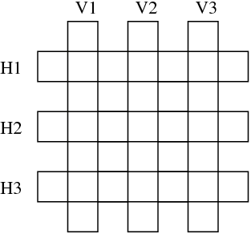

# 3. Crucigrama
Sean las palabras en italiano:

`astante , astoria , baratto , cobalto , pistola , statale .`

Se desea aplicarlas en el siguiente crucigrama:

Escribir una base de datos y una consulta que encuentre una solución al problema.

Consulta: `coinciden(A, B, C, D, E, F).`